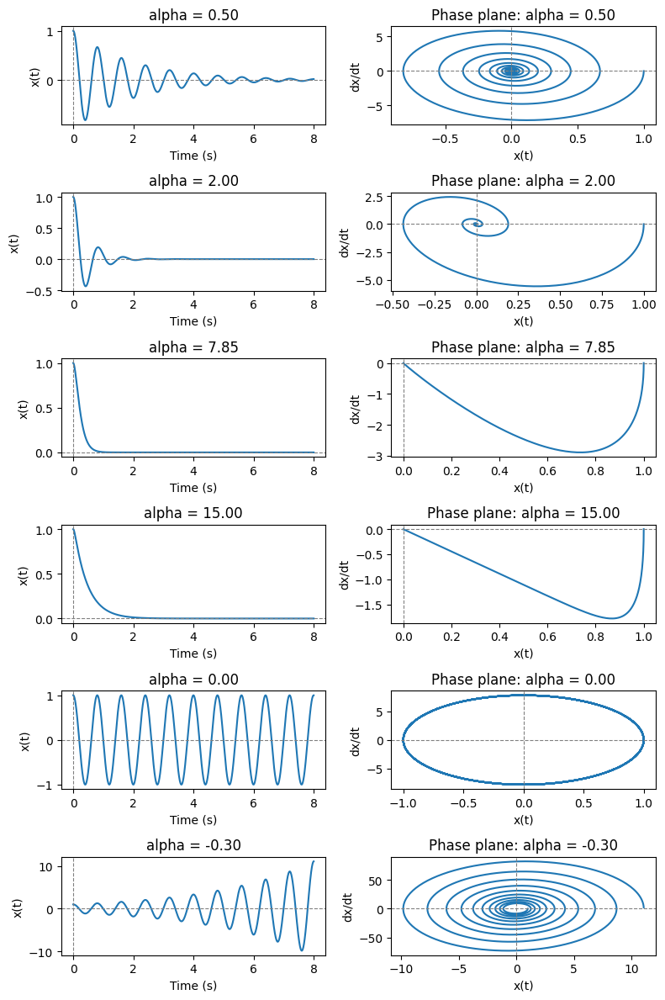
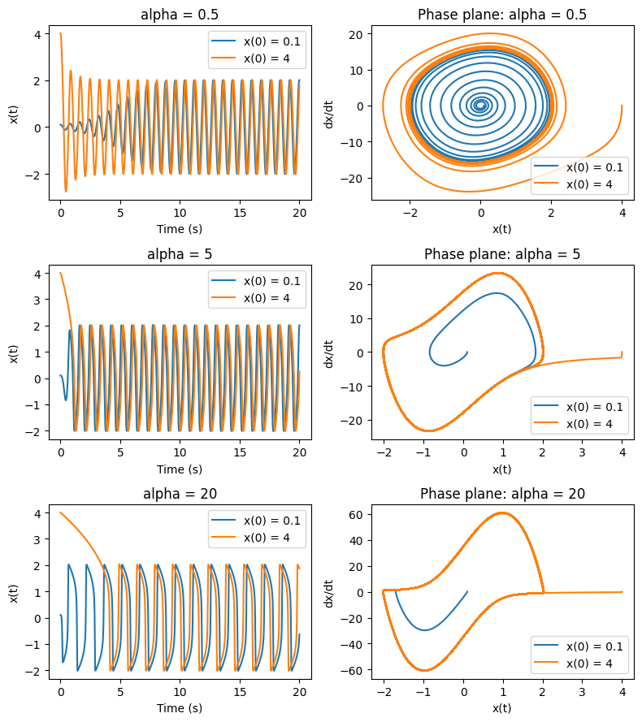
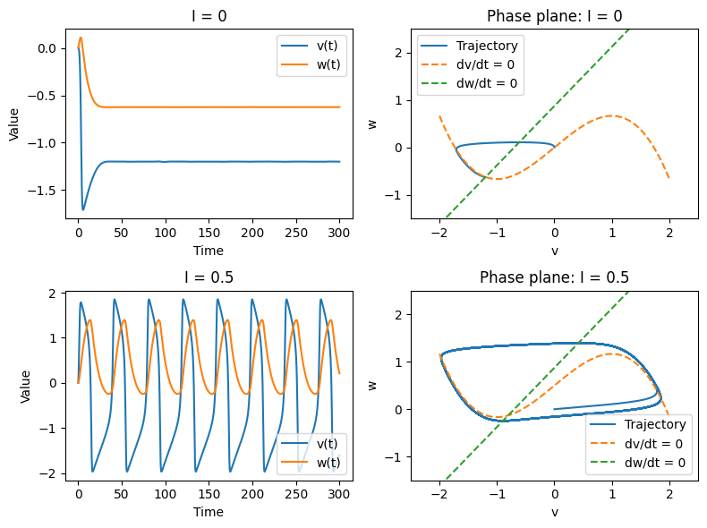
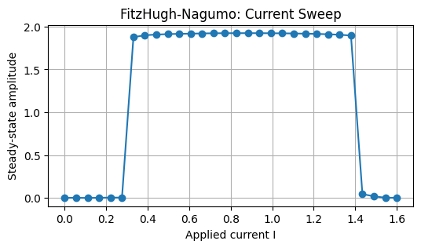
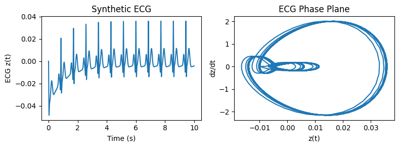
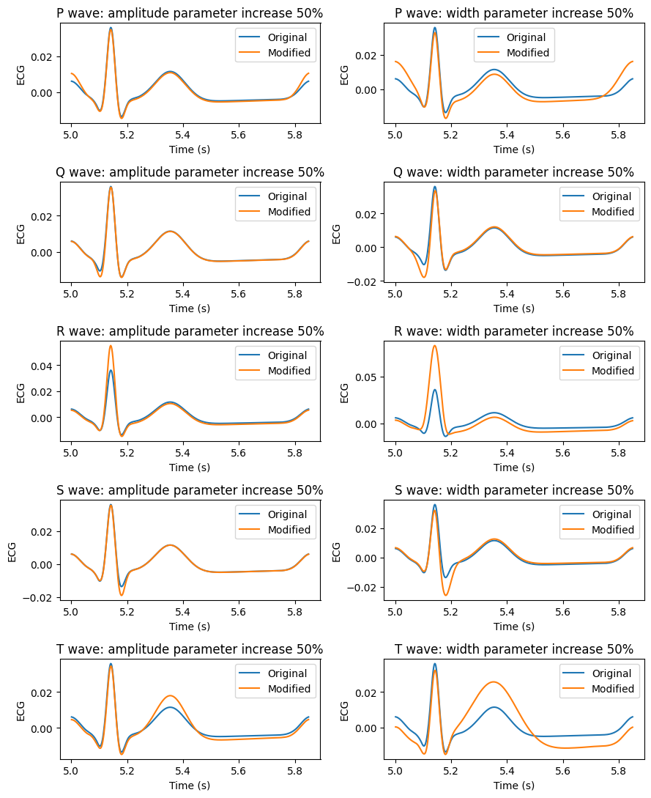
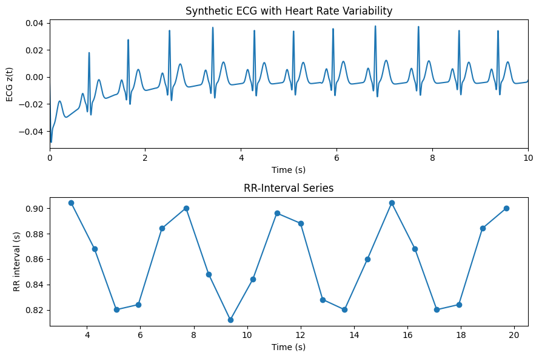
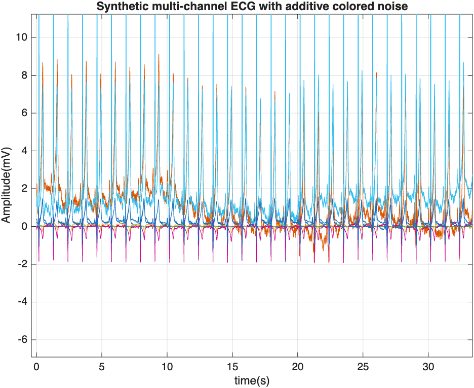
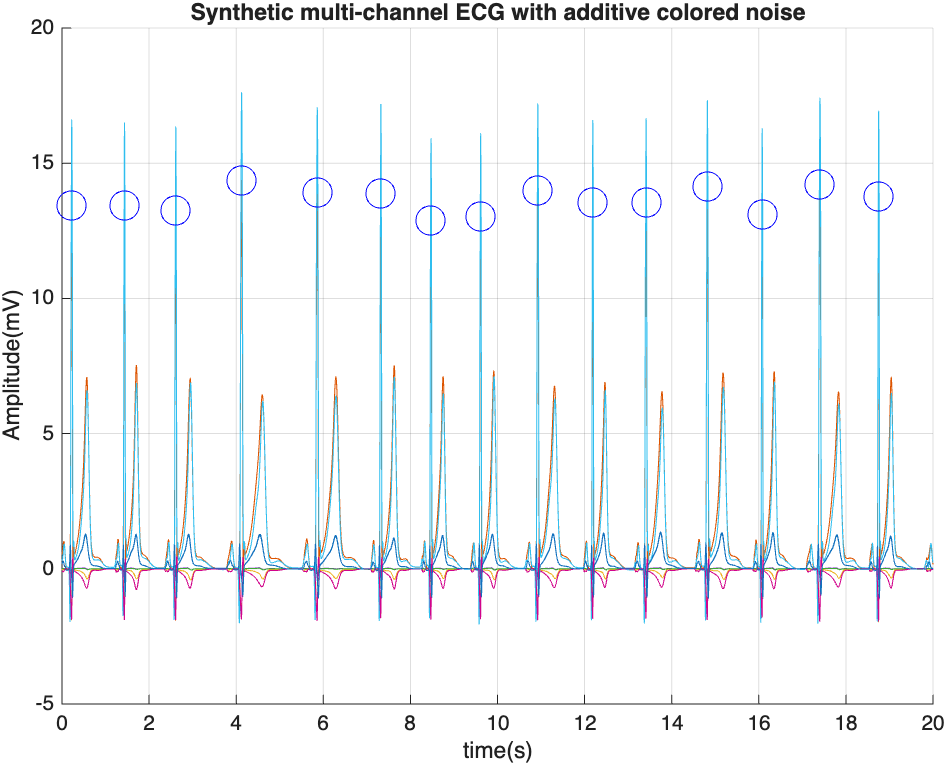
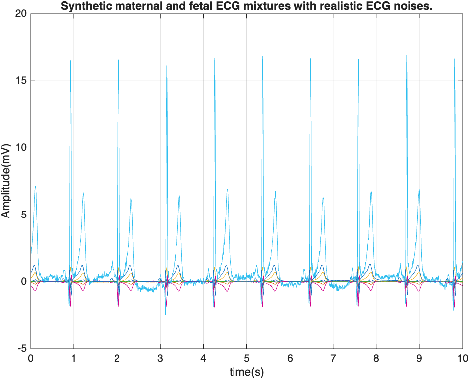

# HW4 — Biopotential Modeling and Synthetic ECG Generation

**Name:** Haoyue Guan
**Email:** hguan28@emory.edu 
**Question:** HW4 — Biopotential Modeling and Synthetic ECG Generation   

## How to run

### Python — Parts A and B

Implement approach: Python with NumPy, SciPy. Install the required packages:

```bash
python -m pip install numpy scipy matplotlib
```

Run each script in BMI500_HW7.ipynb.


### MATLAB Online — Part C

1. Download the [OSET repository](https://github.com/alphanumericslab/OSET) and make it available in MATLAB Online.
2. Set the **main folder to the OSET repository root** (the folder containing `matlab`, `datasets`, and `external`), then run:

```matlab
addpath(genpath(pwd));
```

3. Run the simulation scripts in `matlab/tests/synthetic-ecg-generator/`, specifically `test_ecg_gen_noisy.m`, `testStochasticECGDipoleGenerator.m`, and `test_ecg_gen_fetal_maternal1.m`.

## AI-use statement

**Statement: ChatGPT was used to complete this homework. The full chat is available at: [https://chatgpt.com/share/6ad23bda-8850-83e9-8c1c-dfd61c5a4df7].**

## Part A — Action Potential Dynamics and Oscillations

### A(i). Second-order linear oscillator

The results aligns with the hypothesis. For the underdamped cases (α = 0.5 and 2), the system oscillates with decreasing amplitude and eventually approaches equilibrium. At α = 0.5, the oscillations decay gradually, and when α increases to 2, the amplitude decreases much faster.

At critical damping (α = 7.85), the system returns to equilibrium without oscillating. The overdamped case (α = 15) the critically damped system approaches zero more quickly.

When α = 0, the oscillator maintains a constant amplitude throughout the simulation.

The negative damping (α = −0.3) produces oscillations with increasing amplitude. The phase-plane trajectory spirals outward, showing that the system moves farther from equilibrium.



### A(ii). Van der Pol oscillator

Both conditions x(0) = 0.1 and x(0) = 4 converge to approximately the same stable cycle for all three values of α. The steady state amplitude remains approximately 2 for all three values of α, which suggests that increasing α has little effect on the final oscillation amplitude. The period increases as α becomes larger. At α = 0.5, the period is nearly identical to the linear oscillator's period of 0.8s. At α = 5, the period increases to aound 0.87s and at α = 20 it increases further to 1.49s. This suggests that stronger nonlinear effects increase the oscillation period.

The Van der Pol uses nonlinear damping to regulate the amplitude. When |x| < 1, the damping term becomes negative, adding energy to the system and increasing oscillations. When |x| > 1, the damping becomes positive, removing energy and suppressing oscillations. This mechanism produces a stable limit cycle.



### A(iii). FitzHugh–Nagumo model

The current sweep from I = 0 to 1.6 shows that oscillations occur approximately between I = 0.3 and I = 1.35. The amplitude remains relatively stable at around 1.9. Outside this range the amplitude approaches zero. This suggests that moderate external stimulation produces repetitive oscillation.

The Van der Pol oscillator uses nonlinear damping to regulate the amplitude, allowing oscillations to develop from different initial conditions. As the damping parameter increases, the waveform becomes less sinusoidal. It is simpler for studying self-sustained oscillations, but it does not explicitly describe cellular excitation. The FitzHugh–Nagumo model can produce either a stable resting state or repetitive oscillation depending on the selected current. This makes it more suitable for representing the basic behavior of excitable cells, although it still simplifies biological action potentials. 





## Part B — McSharry–Clifford Synthetic ECG Generation

### B(i). Generate a 10-second synthetic ECG

The ECG phase plane plot shows a repeating loop, which indicates a periodic behavior with different rates of voltage change. The large outer loop reflects rapid voltage changes associated with the sharp QRS complex, and the smaller inner loops reflect slower changes associated with the smoother P and T waves.



### B(ii). Parameter variation

Increasing the amplitude parameters by 50% generally strengthens the ECG components. The P wave shows limited changes, and the Q and S waves shows deeper negative deflections when increase the amplitude. Increasing the R-wave amplitude parameter produces a noticeable R peak, and increasing the T-wave amplitude parameter makes the T wave peak more taller.

Increasing the width parameters changes the shape of the waveforms more noticeable than increasing the amplitude parameters. The P wave shows changes in its surrounding signal, and the Q and S waves become more deeper than changing the amplitude. Increasing the R-wave width parameter produces a substantially taller R peak, and increasing the T-wave width parameter makes the T wave broader and taller.

This results support my hypthesis about the parameters control the QRS complex and T waves. Howerver the changes are more complex than simply increase the peaks, and the width parameter can increase the amplitude as well, which I have not mentioned in the hypothesis.



### B(iii). Heart-rate variability

The results show that introducing heart rate variability causes changes in the spacing between the heartbeats. The RR intervals become shorter when heartbeats increase and extend longer when heart rate slows down. The RR intervals fluctuate between approximately 0.8 to 0.9 seconds. The ECG maintains the PQRST morphology, and small variations in R-peak amplitude and waveform shape can be observed in the time interval. By including the HRV the ECG singal looks more natural and realistic than the previously generated signal with constant heart rate.



## Part C — Multichannel ECG and Stochastic Extensions

### Multichannel ECG with additive colored noise

OSET script: `test_ecg_gen_noisy.m`.

Three codes are executed from the OSET library. The test_ecg_gen_noisy simulation generates multiple ECG channels with different waveform amplitudes. The added colored noise introduces irregular fluctuations, making some ECG components more difficult to identify. This demonstrates how measurement noise can affect ECG signal quality.



### Stochastic multichannel ECG

OSET script: `testStochasticECGDipoleGenerator.m`.

The testStochasticECGDipoleGenerator simulation introduces random variations in heart rate and waveform parameters, including amplitude and width. The results show that the ECG maintains periodic structure, but the spacing and amplitude of individual heartbeats vary. Like what we did in B(iii), these variations make the signal less repetitive and better represent natural physiological changes.



### Maternal–fetal ECG mixtures

OSET script: `test_ecg_gen_fetal_maternal1.m`.

The test_ecg_gen_fetal_maternal1 simulation generates multichannel ECG signals containing maternal-fetal cardiac activity. The model specifies a maternal heart rate of 54 bpm and a fetal heart rate of 132 bpm. The prominent peaks appear approximately every 1.1 seconds shown in plot.



### Why stochastic ECG modeling matters for machine learning

Stochastic modeling is important because real ECG recordings contain natural variations in heartbeat and measurement noise. Training machine learning models using perfectly repetitive synthetic signals may cause them to learn unrealistic patterns that do not generalize well to real patients. Introducing random parameter variations and realistic noise can increase data diversity and potentially improve model robustness.

## Discussion — Hypothesis revisited

- **A(i) — Supported.** Positive damping reduced oscillations, zero damping preserved amplitude, and negative damping caused growing oscillations.
- **A(ii) — Supported.** Both initial conditions converged to the same limit cycle and amplitude stayed near 2 while period increased as nonlinear damping increased.
- **B — Partially supported.** The model generated the PQRST morphology, and QRS and T kernel changes affected their corresponding features. The changes are more complex than simply increase the peaks, and the width parameter can increase the amplitude as well, which I have not mentioned in the hypothesis.


